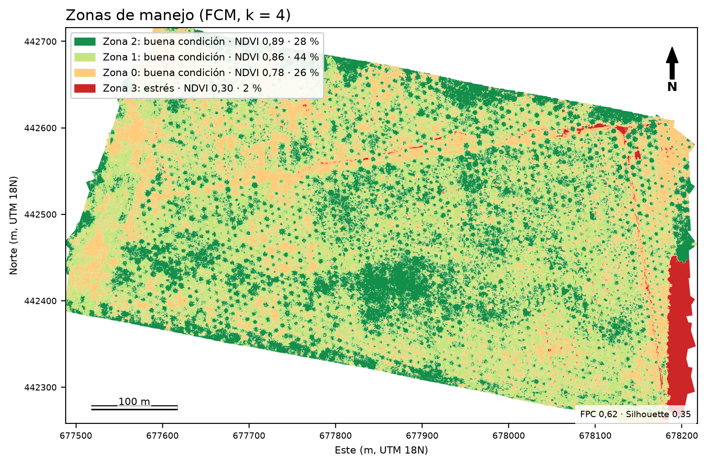
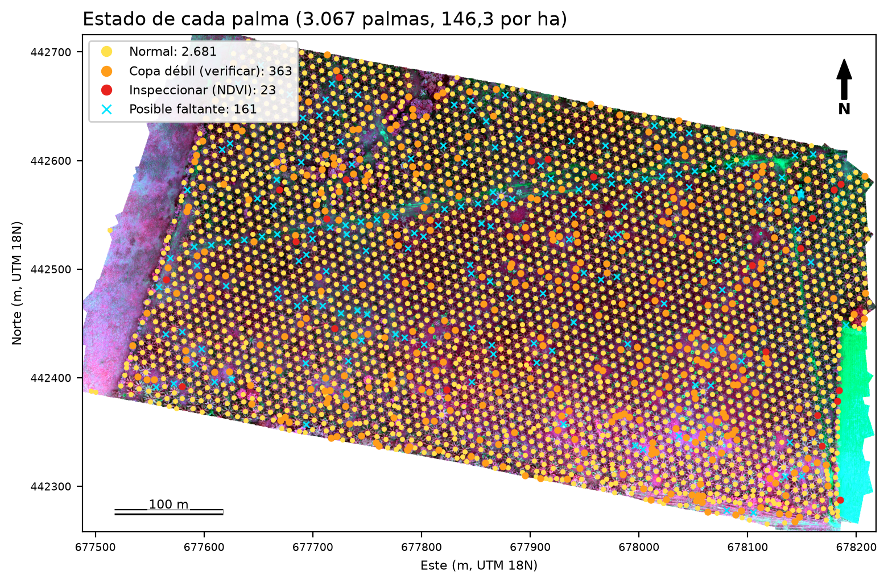

# Motor GeoAI Analítico M2M (versión 1.3)

API REST que analiza ortomosaicos multiespectrales de dron (DJI Mavic 3M procesados en Pix4Dfields) y entrega:

- la condición del cultivo por rangos de NDVI según el criterio del experto agronómico, con el porcentaje y el área de cada rango;
- zonas de inspección georreferenciadas (NDVI entre 0,2 y 0,5) con coordenadas GPS;
- una zonificación por Fuzzy C-Means (FCM) sobre NDVI, NDRE y GNDVI, y patrones espaciales con DBSCAN, cada uno con su capa para QGIS;
- la transición entre zonas: qué parte de cada zona tiene una asignación poco segura y con qué otra zona se mezcla, más un mapa de zonas con esa clase;
- en palma de aceite, el conteo de palmas, el NDVI de cada copa, las palmas a inspeccionar y los posibles faltantes;
- la comparación contra una línea base validada por el experto: los vuelos nuevos se clasifican con los centroides congelados de la línea base y el cambio se reporta por zona;
- la explicabilidad del modelo (prototipos, importancia por permutación, reglas de un árbol sustituto y explicación exacta por píxel) y un mapa de incertidumbre;
- los puntos de verificación para evaluar la exactitud temática con matriz de confusión, exactitudes y Kappa.

Proyecto de grado de Samuel Jesús Mejía Díaz y Julián Alexander Díaz Ortiz, Pontificia Universidad Javeriana.

La explicación completa del método, la validez y la explicabilidad, con referencias, está en `METODOLOGIA.md`. Los cambios de cada versión están en `CAMBIOS_v1_2.md` y `CAMBIOS_v1_3.md`.

---

## 1. Contenido

```
geoai-engine-main/
├── app/                        Código de la API (monolito por capas, patrón MVC)
│   ├── main.py                 Aplicación FastAPI
│   ├── controllers/
│   │   └── analyze_router.py   Endpoints, trabajos asíncronos y líneas base persistentes
│   ├── models/
│   │   ├── raster_processor.py Lectura del GeoTIFF, bandas por nombre, NDVI, NDRE y GNDVI
│   │   ├── aoi.py              Polígono del lote: lectura, validación y recorte
│   │   ├── spatial_segmenter.py FCM, transición entre zonas, DBSCAN, métricas y comparación con la línea base
│   │   ├── condition_report.py Rangos de NDVI del experto y zonas de inspección
│   │   ├── palm_analyzer.py    Conteo y análisis por palma
│   │   ├── explainability.py   Prototipos, permutación, árbol sustituto, explicación local, incertidumbre
│   │   ├── accuracy.py         Muestreo estratificado y matriz de confusión
│   │   └── crop_profiles.py    Escala de NDVI por cultivo y su fuente
│   └── views/
│       └── response_serializer.py JSON, GeoJSON, resumen en texto y GeoTIFF
├── tests/                      79 pruebas automáticas con imágenes sintéticas
├── experiments/                Experimentos reproducibles y mapas en PNG
├── sample_data/
│   └── palma_muestra.tif       Recorte de 90 × 90 m del lote de palma (28 MB)
├── resultados_referencia/      Salidas de las pruebas y los experimentos, con los mapas del lote
├── METODOLOGIA.md              Método, validez, explicabilidad, glosario y referencias
├── CAMBIOS_v1_2.md             Cambios de la v1.2 y sus pruebas
├── CAMBIOS_v1_3.md             Cambios de la v1.3 y sus pruebas
├── requirements.txt            Dependencias de la API
├── requirements-dev.txt        Dependencias para correr las pruebas y los experimentos
├── pytest.ini
├── Dockerfile
└── docker-compose.yml
```

## 2. Instalación

Requiere Python 3.11 o superior. Probado en Windows 11 con Python 3.11.9 (v1.2) y 3.14.4 (v1.3).

```bash
python -m venv .venv
```

```bash
.venv\Scripts\activate
```

(En Linux o macOS: `source .venv/bin/activate`)

```bash
python -m pip install -r requirements-dev.txt
```

## 3. Pruebas automáticas

```bash
python -m pytest -v
```

Resultado esperado: 79 passed en uno o dos minutos. El reporte obtenido está en `resultados_referencia/pruebas_pytest.txt`.

Las pruebas no necesitan los ortomosaicos reales. Cada una genera una imagen sintética con la misma estructura que exporta Pix4Dfields (5 bandas float32: Green, Red, Red edge, NIR y Alpha; nodata −10000; EPSG:32618), con valores de NDVI, NDRE y GNDVI conocidos, para comparar el resultado con la respuesta correcta. Los generadores están en `tests/conftest.py`.

| Archivo | Qué verifica |
|---|---|
| `test_raster_processor.py` | Bandas identificadas por su nombre; índices con valores conocidos; máscara Alpha y umbral de vegetación; un único factor de escala. Incluye la prueba de regresión del error que leía la banda Alpha como infrarrojo. |
| `test_crop_profiles.py` | La escala de NDVI del codirector: rangos contiguos y clasificación de valores límite (0,2, 0,5, 0,6). |
| `test_condition_report.py` | Porcentaje y área por rango; zonas de inspección con coordenadas GPS; descarte de parches menores a 10 m²; lenguaje neutral. |
| `test_spatial_segmenter.py` | FCM recupera tres condiciones conocidas (pureza > 99 %); reproducibilidad; métricas en rango; línea base congelada: mismo vuelo sin cambio, y con estrés simulado en la mitad del lote, 0 % de cambio falso en la mitad que no cambió; cambio por zona con etiquetas del experto; error si k no coincide con la línea base. |
| `test_transicion.py` | En un lote que pasa poco a poco de palma vigorosa a estrés, los píxeles de transición quedan solo dentro del degradado; cada uno se mezcla con la otra zona; el reporte por zona cuadra con los píxeles; el mapa de zonas trae la clase 200; FCM separa las zonas aunque la imagen tenga miles de píxeles idénticos. |
| `test_palm_analyzer.py` | Plantación sintética a 9 m en triángulo con una palma faltante y una enferma: conteo, densidad, cada palma detectada una sola vez, faltante reportada, enferma marcada para revisión y sin falsas alarmas en palmas sanas. |
| `test_explainability.py` | Pertenencia FCM; la explicación local suma exactamente la decisión; la importancia por permutación identifica el único índice informativo; fidelidad del árbol sustituto; prototipos en unidades originales. |
| `test_accuracy.py` | Matriz de confusión, exactitudes y Kappa contra valores calculados a mano; muestreo estratificado (puntos por zona, distancia mínima, reproducible); puntos a ciegas sin la zona del modelo. |
| `test_api.py` | Flujo completo por HTTP: validaciones de entrada, análisis genérico y de palma, todos los endpoints de resultado, explicabilidad, descarga del mapa de incertidumbre, exactitud temática, creación de la línea base con etiquetas, persistencia tras reiniciar y comparación contra la línea base. |
| `test_lote.py` | Fuera del polígono del lote los píxeles quedan sin dato; el polígono en otro sistema de coordenadas se reproyecta; un polígono que no se cruza con la imagen o un archivo sin polígonos dan error; por la API, el lote cambia los porcentajes, queda en la línea base y el vuelo siguiente lo usa. |
| `test_mapas.py` | El análisis completo y los cinco mapas en PNG se generan sobre la plantación sintética, también con el polígono del lote. |
| `test_robustez.py` | Banda Alpha detectada por *color interpretation*; "Near infrared" no se confunde con rojo; el `job_id` del resultado es el de la API; el umbral de NDVI queda registrado y la línea base lo impone; área real de cada polígono; patrones DBSCAN en GeoJSON; respuesta 409 mientras el análisis no termina; nombres de archivo con rutas. |

## 4. Probar la API con la imagen de muestra

Levantar el servidor:

```bash
uvicorn app.main:app --reload
```

Abrir la documentación interactiva en <http://127.0.0.1:8000/docs>. Desde allí se puede probar cada endpoint con el botón *Try it out*.

Con línea de comandos:

```bash
curl -F "file=@sample_data/palma_muestra.tif" -F "crop_type=palma" http://127.0.0.1:8000/api/v1/analyze
```

Conviene enviar también el polígono del lote, para que solo se analice el área sembrada. Se dibuja en QGIS y se exporta como GeoJSON; puede estar en cualquier sistema de coordenadas:

```bash
curl -F "file=@sample_data/palma_muestra.tif" -F "aoi=@lote.geojson" -F "crop_type=palma" http://127.0.0.1:8000/api/v1/analyze
```

Los píxeles de afuera quedan sin dato: no cuentan en los rangos de NDVI, las zonas, las palmas ni los puntos de verificación. El área del lote sale en `data_provenance.lote_area_ha`.

La respuesta trae un `job_id`. Con él:

| Endpoint | Qué devuelve |
|---|---|
| `GET /api/v1/status/{job_id}` | Estado: queued, processing, completed o failed |
| `GET /api/v1/result/{job_id}` | Resultado completo en JSON |
| `GET /api/v1/result/{job_id}/summary` | Resumen en texto |
| `GET /api/v1/result/{job_id}/geojson` | Zonas FCM (se abre en QGIS). `area_ha` es el área de cada polígono y `zone_area_ha` la de toda la zona |
| `GET /api/v1/result/{job_id}/patterns` | Patrones espaciales de DBSCAN, un polígono por patrón |
| `GET /api/v1/result/{job_id}/zones-map` | Mapa de zonas (GeoTIFF): número de zona en cada píxel, 200 = transición, 255 = sin dato |
| `GET /api/v1/result/{job_id}/uncertainty` | Mapa de incertidumbre (GeoTIFF, % de pertenencia) |
| `GET /api/v1/result/{job_id}/inspection` | Zonas de inspección con coordenadas |
| `GET /api/v1/result/{job_id}/palms` | Cada palma con su estado y los posibles faltantes |
| `GET /api/v1/result/{job_id}/accuracy-sample` | Puntos de verificación estratificados por zona, sin la zona del modelo |
| `POST /api/v1/result/{job_id}/accuracy` | Matriz de confusión, exactitud global, del usuario, del productor y Kappa |
| `GET /api/v1/crops` | Cultivos soportados, rangos de NDVI y fuente de los umbrales |

Mientras el análisis está en cola o en proceso, los endpoints de resultado responden 409 con el estado actual. Por defecto se procesa un análisis a la vez (`GEOAI_MAX_CONCURRENT_JOBS`), porque un ortomosaico completo ocupa varios GB de memoria.

El JSON del resultado incluye, además de las zonas:

- `transicion`: porcentaje de píxeles de transición entre zonas (pertenencia menor a 0,6), y para cada zona qué parte está en transición y con qué otra zona se mezcla. No es el rango "transición" de NDVI 0,5–0,6 de la escala del codirector, que aparece en `condicion_por_rangos`;
- `explicabilidad`: prototipos, importancia por permutación, reglas del árbol sustituto con su fidelidad, explicaciones locales e incertidumbre;
- `analysis_params`: todos los parámetros del análisis, incluidos el umbral de NDVI y el cultivo, para que el resultado se pueda reproducir.

Para ver la transición en QGIS, se abre el GeoTIFF de `zones-map` con simbología de valores únicos en paleta y se pinta el valor 200 en gris.

Para la exactitud temática se envía la clase que el experto observó en cada punto:

```bash
curl -H "Content-Type: application/json" -d "{\"referencias\": {\"1\": \"Vegetación sana\", \"2\": \"Suelo desnudo o camino\"}, \"zone_labels\": {\"2\": \"Vegetación sana\", \"3\": \"Suelo desnudo o camino\"}}" http://127.0.0.1:8000/api/v1/result/JOB_ID/accuracy
```

La muestra se procesa en unos 10 segundos. La salida esperada está en `resultados_referencia/muestra/`, incluidos `zonas_transicion.tif` y `patrones_dbscan.geojson`.

## 5. Línea base (modelo de referencia)

1. Analizar el vuelo base (paso anterior) y validar sus zonas con el experto.
2. Registrar la línea base con el nombre que el experto le da a cada zona:

```bash
curl -F "name=PALMA vuelo base" -F "validated_by=Codirector" -F "zone_labels={\"2\": \"Palma vigorosa\", \"3\": \"Borde o suelo\"}" http://127.0.0.1:8000/api/v1/reference/JOB_ID
```

3. Analizar un vuelo posterior del mismo lote contra esa línea base:

```bash
curl -F "file=@vuelo_nuevo.tif" -F "crop_type=palma" -F "reference_model_id=REFERENCE_ID" http://127.0.0.1:8000/api/v1/analyze
```

Con una línea base, el análisis usa el k, el umbral de NDVI y el polígono del lote de la línea base, aunque se envíen otros k o umbral, para que los dos vuelos se comparen sobre la misma área y las mismas zonas. Si se envía otro polígono junto con la línea base, la API responde 422.

El resultado incluye `drift_report`, con el cambio de área de cada zona (por número de zona y con el nombre del experto) y el desplazamiento de los centroides. Las líneas base se guardan como JSON en `data/references/` (o en la carpeta indicada en `GEOAI_REF_DIR`) y se recargan al reiniciar el servidor.

## 6. Experimentos con ortomosaicos reales

Necesitan el ortomosaico completo (`Ortomosaico.data.tif`, 1 a 1,5 GB), que no se incluye por tamaño. Cada script recibe la ruta del archivo; todos funcionan también con `sample_data/palma_muestra.tif`.

| Script | Qué mide | Resultado guardado |
|---|---|---|
| `experiments/analisis_completo.py` | El pipeline completo sin la API, con todas las salidas (también el mapa de transición y los patrones DBSCAN). Con `--lote` recorta con el polígono del lote | `palma_resumen.txt`, `muestra/` |
| `experiments/linea_base_estres.py` | Línea base: cambio falso y detección con estrés simulado | `linea_base_estres_palma.txt` |
| `experiments/seleccion_k.py` | Número de zonas con FPI, entropía, FPC, Silhouette y Davies-Bouldin (acepta `--lote`) | `seleccion_k_palma.txt`, `seleccion_k_platano.txt` |
| `experiments/sensibilidad_escala.py` | Efecto de la unidad de análisis (píxel, 0,5, 1 y 2 m) | `sensibilidad_escala_palma.txt`, `sensibilidad_escala_platano.txt` |
| `experiments/explicabilidad.py` | Tabla de atributos de píxeles reales, prototipos, permutación, explicación local y árbol de reglas | `explicabilidad_palma.txt` |
| `experiments/exactitud_tematica.py` | `formulario`: Excel a ciegas con los puntos de verificación. `evaluar`: matriz de confusión con el Excel diligenciado | `muestra/verificacion_exactitud.xlsx` |
| `experiments/mapas.py` | Mapas en PNG a partir de la carpeta de `analisis_completo.py`: zonas FCM, transición, incertidumbre, zonas de inspección con patrones DBSCAN y estado de cada palma | `mapas_palma/`, `muestra/mapas/` |
| `experiments/contraste_escala_experto.py` | La escala de NDVI del codirector aplicada a la reflectancia de cada punto y polígono, frente al rango que el modelo le dio a cada zona (consistencia interna, no reemplaza al experto) | `contraste_escala_palma.txt`, `muestra/contraste_escala_experto.xlsx` |

Ejemplo:

```bash
python experiments/seleccion_k.py ruta/al/Ortomosaico.data.tif
```

### Mapas

Los mapas se generan a partir de la carpeta de `analisis_completo.py`. Con `--tif`, las zonas de inspección y las palmas se dibujan sobre el ortomosaico en falso color (NIR, rojo, verde). Si el análisis se hizo con `--lote`, se dibuja su límite y los mapas se encuadran en él.

```bash
python experiments/analisis_completo.py ruta/al/Ortomosaico.data.tif salida_palma --cultivo palma --lote lote.geojson
```

```bash
python experiments/mapas.py salida_palma --tif ruta/al/Ortomosaico.data.tif
```

| Mapa | Qué muestra |
|---|---|
| `01_zonas_fcm.png` | Zonas FCM coloreadas de mayor a menor NDVI, con su rango de la escala del codirector y el porcentaje del área |
| `02_transicion.png` | Las mismas zonas con los píxeles de transición en gris |
| `03_incertidumbre.png` | Pertenencia de cada píxel a su zona, en porcentaje |
| `04_inspeccion_y_patrones.png` | Zonas de inspección (NDVI 0,2–0,5) y patrones DBSCAN sobre el ortomosaico |
| `05_palmas.png` | Cada palma con su estado: normal, copa débil, a inspeccionar o posible faltante |

Los mapas del lote completo están en `resultados_referencia/mapas_palma/` y los de la muestra en `resultados_referencia/muestra/mapas/`.





### Resultados obtenidos (lote de palma, Meta, abril de 2025, 6 cm/píxel)

El análisis completo y los mapas del lote se repitieron con la v1.3; los demás experimentos del lote completo son de la v1.2. La v1.3 asigna cada píxel a la misma zona; las áreas solo cambian desde el cuarto decimal, porque ahora se calculan con la resolución sin redondear.

| Medida | Resultado | Archivo en `resultados_referencia/` |
|---|---|---|
| Condición por rangos del experto | 96,85 % con NDVI > 0,6; 0,75 % en transición; 2,24 % en estrés (0,54 ha en 14 zonas de inspección); 0,16 % suelo. El 90 % del área de inspección es una sola franja sin palma del borde este, y el resto son sobre todo vías internas (ver `mapas_palma/04_inspeccion_y_patrones.png`) | `palma_resumen.txt` |
| Zonificación FCM (k = 4) | Silhouette 0,345; Davies-Bouldin 0,812; FPC 0,624 (sin estructura sería 0,25) | `palma_resumen.txt` |
| Número de zonas | Sobre toda la imagen, FPI y entropía con mínimo en k = 3 en los dos lotes (palma: 0,400 y 0,407; plátano: 0,371 y 0,406). En palma, con el polígono aproximado del lote ese mínimo desaparece (FPI en k = 2, entropía en k = 4): la tercera zona era la franja sin palma | `seleccion_k_*.txt`, `lote_aproximado/` |
| Línea base | Mismo vuelo: 100 % de coincidencia. Estrés simulado en la mitad del lote: 0,0 % de cambio falso en la mitad sin cambio (34,2 % con la versión anterior) y 64,9 % de la mitad estresada baja de zona | `linea_base_estres_palma.txt` |
| Explicabilidad | Al desordenar NDRE cambia de zona el 42,8 % de los píxeles; GNDVI 28,0 %; NDVI 16,6 %. Árbol sustituto con fidelidad del 89,9 %. 23,8 % de píxeles de transición | `explicabilidad_palma.txt` |
| Transición entre zonas | 23,8 % de los píxeles: 27,3 % de la zona 0, 25,8 % de la zona 1, 18,4 % de la zona 2 y 11,9 % de la zona de estrés. Las zonas se mezclan en cadena (2 con 1, 1 con 0, 0 con la de estrés). En la muestra, con k = 3 la transición baja de 15,1 % a 7,1 % | `palma_resumen.txt`, `mapas_palma/02_transicion.png` |
| Escala (MAUP) | Palma: con k = 4, Silhouette 0,345 por píxel y 0,358 con celdas de 2 m. Plátano: con k = 3, 0,502 por píxel y 0,619 con celdas de 2 m | `sensibilidad_escala_*.txt` |
| Análisis por palma | 3.067 palmas, 146,3/ha (142,6 esperadas a 9 m en triángulo); 23 a inspeccionar por NDVI; 363 copas débiles; 161 posibles faltantes | `palma_resumen.txt` |
| Contraste con la escala del codirector | 116 de 120 puntos y 36 de 36 polígonos caen en el rango que el modelo le dio a su zona. Las zonas 0, 1 y 2 quedan las tres en "buena condición": la escala no las separa (las separa NDRE) ni dice qué cobertura hay | `contraste_escala_palma.txt` |
| Exactitud temática | 120 puntos estratificados (30 por zona) listos para la verificación del experto | Formato en la carpeta de documentos de la entrega |
| Con el polígono aproximado del lote (22,7 ha) | NDVI 0,2–0,5 baja de 2,24 % a 0,93 % (0,21 ha); ya no hay zona FCM de estrés: la de menor NDVI (0,57) son vías y bordes de copa; 3.053 palmas; 91 patrones DBSCAN en lugar de 1.075 | `lote_aproximado/` |
| Tiempo y memoria (API, lote completo de 1,5 GB) | Subida en 5 s con 0,2 GB de memoria; análisis completo en 184 s con un pico de 5,4 GB en el servidor (Windows 11, 23 GB de RAM). El GeoJSON de zonas pesa 50 MB | — |

## 7. Docker

```bash
docker compose up --build
```

La API queda en <http://localhost:8000/docs>; las líneas base se guardan en `./data/references` y los mapas de cada análisis en `./data/results`. El Dockerfile instala GDAL en una imagen `python:3.11-slim`. Esta vía todavía no se ha probado: las pruebas se corrieron con Python directamente.

## 8. Limitaciones conocidas

- No hay todavía dos vuelos del mismo lote. La línea base se valida con un vuelo simulado (estrés controlado); falta un segundo vuelo real.
- La interpretación de las zonas por el experto (pureza por zona) y la exactitud temática con los 120 puntos de verificación están pendientes; los formatos están listos.
- El conteo de palmas no se ha comparado con un conteo en campo. Arbustos en linderos pueden contarse como palmas y vías internas pueden aparecer como posibles faltantes.
- Falta el polígono oficial del lote PALMA. Sin él, los porcentajes se calculan sobre toda el área con datos de la imagen, y en PALMA la zona FCM de estrés y la mayor zona de inspección quedan en una franja sin palma del borde este y en las vías: el 2,24 % en estrés no corresponde a palmas afectadas. El recorte ya está implementado (`aoi` en la API, `--lote` en los experimentos).
- El Mavic 3M no tiene banda azul ni infrarrojo de onda corta: no se calcula EVI y el estrés hídrico solo se infiere.
- Por encima de NDVI 0,6, las subzonas requieren calibración con datos de campo.
- Los trabajos de análisis se guardan en memoria; se pierden si el servidor se reinicia (las líneas base sí persisten).
- La selección de k, la línea base, la explicabilidad y la escala del lote completo no se han repetido con la v1.3 (el análisis completo y los mapas sí).
